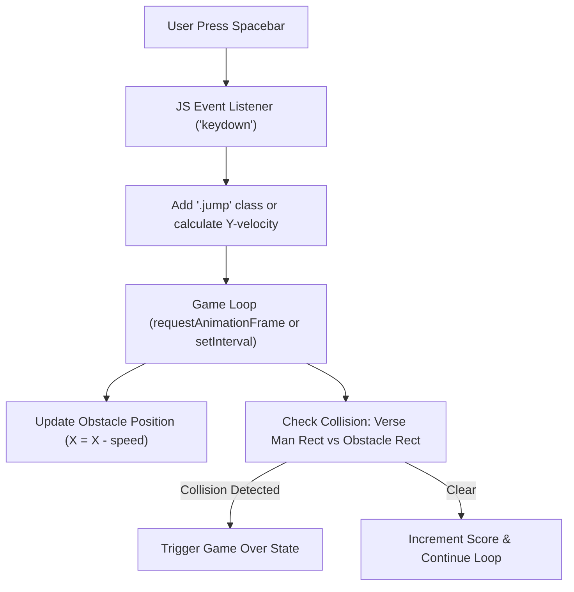

# VERSE-RUN — Game Blueprint
**Organisation:** C-VERSE  
**Project:** VERSE-RUN  
**Document Version:** 1.0 (Week 1 — Day 1 Deliverable)  
**Target Audience:** Students & Beginner Developers  

---

## 1. Project Overview & Identity

**VERSE-RUN** is an original 2D endless runner browser game developed under the C-VERSE educational framework. The project is engineered to teach beginners the fundamentals of web development and programming from scratch using pure web standards.

- **Main Character:** Verse Man (an original C-VERSE pixel hero)
- **Game Type:** 2D Side-Scrolling Endless Runner
- **Platform:** Modern Web Browsers (Desktop & Mobile)
- **Technology Stack:**
  - **HTML5:** Semantic structure and game screen layout
  - **CSS3:** Visual styling, positioning, layout, and sprite animations
  - **Vanilla JavaScript (ES6+):** Game loops, event handling, physics calculations, and state management
- **Core Constraints:**
  - Zero external libraries or frameworks (No React, No Phaser, No TypeScript).
  - No backend or database requirements.
  - Transparent, beginner-accessible code architecture.
  - Original assets — no proprietary or copyrighted art (e.g., Google Dinosaur).

---

## 2. Game Concept

Verse Man embarks on a continuous run through a dynamic digital landscape. As Verse Man runs forward, obstacles scroll toward him at increasing speeds. The player must time actions (jumps and dodges) to leap over obstacles, collect C-VERSE energy orbs, and survive as long as possible to achieve the highest score.

### Core Game Loop:
1. **Ready:** Verse Man waits on the runway.
2. **Run:** The world begins moving; score accumulates with distance.
3. **React:** Obstacles appear; player presses space/touch to jump.
4. **Escalate:** Running speed gradually increases over time.
5. **Game Over:** Collision stops the run, displays final statistics, and prompts immediate restart.

---

## 3. Gameplay Blueprint

### 3.1 Player Character (Verse Man)
- **Position:** Anchored horizontally on the left third of the screen.
- **States:**
  - *Idle:* Standing posture when the game has not started.
  - *Running:* Continuous two-frame running cycle while running on the ground.
  - *Jumping:* Rising and falling trajectory when the player initiates a jump.
  - *Game Over:* Collision reaction frame indicating defeat.

### 3.2 Game Environment
- **Ground Track:** A horizontal strip at the bottom of the screen with a repeating texture that scrolls left to simulate forward momentum.
- **Background / Sky:** A stylized digital backdrop (skyline or digital horizon) creating visual depth.
- **Day / Night Transition:** Visual palette shifts gradually as distance increases (Week 4 feature).

### 3.3 Obstacles
- **Ground Obstacles:** Digital barriers, data spikes, or cyber blocks requiring a standard jump.
- **Variable Spacing:** Generated at pseudo-random intervals so players cannot simply jump on a fixed rhythm.
- **Airborne Obstacles (Week 4):** Low-flying cyber drones requiring timing or ducking.

### 3.4 Player Controls
- **Desktop Controls:**
  - `Spacebar` or `ArrowUp`: Jump.
  - `ArrowDown` (Week 4): Fast drop / Duck.
- **Mobile / Touch Controls (Week 4):**
  - Tap on screen or dedicated touch button: Jump.

### 3.5 Scoring System
- **Distance Score:** Starts at `00000` and ticks up continuously based on survival time/distance.
- **Bonus Tokens:** Collectible C-VERSE energy orbs that award bonus points.
- **High Score:** Persisted locally in the browser so players can challenge their personal best.

### 3.6 Win & Game Over Rules
- **Endless Nature:** There is no final "win" screen; the objective is survival and score maximization.
- **Collision:** When the bounding box of Verse Man intersects with any obstacle's bounding box, running stops immediately.
- **Restart:** The player can press `Spacebar` or click "Try Again" to reset variables and immediately launch a new run.

---

## 4. Screen Blueprint

The game interface is housed inside a fixed-aspect container (`#game-container`) divided into three distinct screens/states:

```
+-----------------------------------------------------------+
| VERSE-RUN                              HI 00540   00120   |
|                                                           |
|                                                           |
|             [ AIR HAZARD ]                                |
|                                                           |
|   [VERSE MAN]                     [GROUND OBSTACLE]       |
|===========================================================|
|/////////////////////// GROUND ////////////////////////////|
+-----------------------------------------------------------+
```

### Screen 1: Start Screen
- **Title Banner:** "VERSE-RUN" logo.
- **Character Idle Pose:** Verse Man positioned on the ground.
- **Instruction Prompt:** "Press SPACEBAR or Tap to Run".

### Screen 2: Active Game Screen (HUD & Play Area)
- **HUD (Heads-Up Display):**
  - High Score indicator: `HI 00000`
  - Current Score counter: `00000`
- **Play Area:**
  - Scrolling ground track.
  - Verse Man animated runner.
  - Dynamically spawned obstacles moving from right to left.
  - Collectible tokens.

### Screen 3: Game Over Screen
- **Banner:** "GAME OVER" text overlay.
- **Score Summary:**
  - Final Distance / Score.
  - High Score (with "NEW RECORD" highlight if broken).
- **Restart Button / Prompt:** "Press SPACEBAR or Click to Restart".

---

## 5. Technical Blueprint

### 5.1 Architecture: The Three Web Pillars
For beginners, web development concepts are best understood through functional separation:

| Pillar | Role in VERSE-RUN | Beginner Analogy |
| :--- | :--- | :--- |
| **HTML** | Defines every visual component (`#game-container`, `#verse-man`, `#ground`, `#score`) | The Skeleton |
| **CSS** | Sizes, colors, positions elements (`bottom`, `left`), and animates sprites | The Skin & Clothes |
| **JavaScript** | Detects input, runs the game loop, updates coordinates, checks collisions | The Brain & Muscles |

### 5.2 Rendering Approach: DOM & CSS vs Canvas
- **Approach Chosen:** DOM elements with CSS absolute positioning and classes.
- **Why this is chosen:** 
  Beginners can open the browser Developer Tools, inspect `#verse-man` or `#obstacle`, see their live CSS properties, and immediately connect code to visual output. HTML5 `<canvas>` hides internal objects inside a script-only rendering context, which makes debugging far harder for first-time learners.

### 5.3 Technical Flow Diagram


---

## 6. Asset Blueprint

All visual and audio assets will be lightweight, original, and introduce retro pixel charm. *Note: No assets are generated or downloaded during Day 1.*

### 6.1 Visual Sprites
1. **Verse Man Sprites:**
   - `verse_man_idle.png`: Standing ready.
   - `verse_man_run1.png` & `verse_man_run2.png`: 2-frame running walk cycle.
   - `verse_man_jump.png`: Leaping airborne pose.
   - `verse_man_crash.png`: Collision / defeat pose.
2. **Environment:**
   - `ground_texture.png`: Seamless repeating ground strip.
   - `cloud.png` / `city_bg.png`: Background parallax elements.
3. **Obstacles & Rewards:**
   - `obstacle_small.png`: Single ground obstacle.
   - `obstacle_large.png`: Double/tall ground obstacle.
   - `obstacle_bird.png`: Airborne flying obstacle (Week 4).
   - `energy_token.png`: Bonus collectible item.

### 6.2 Audio Assets (Week 4)
- `jump.wav`: Quick 8-bit rising tone.
- `point.wav`: Milestone score chime.
- `hit.wav`: Retro crunch on obstacle collision.

---

## 7. 20-Day Progressive Development Roadmap

- **WEEK 1 — WEB FOUNDATIONS**
  - **Day 1 (Today):** Project Understanding & Game Blueprint (`docs/VERSE_RUN_GAME_BLUEPRINT.md`).
  - **Day 2:** HTML — Page structure, viewport setup, game screen containers.
  - **Day 3:** CSS — Styling Verse Man, stage backdrop, and retro typography.
  - **Day 4:** CSS — Positioning, layout, ground alignment, and CSS animation principles.
  - **Day 5:** JavaScript — Intro to script linking, variables, and jumping with click/spacebar events.

- **WEEK 2 — PROGRAMMING THE GAME**
  - **Day 6:** Variables & Data Types — Storing score, jump velocity, and game status.
  - **Day 7:** Operators & Conditionals — Jump boundary conditions and collision criteria rules.
  - **Day 8:** Functions & Reusable Logic — `jump()`, `startGame()`, and `resetGame()` functions.
  - **Day 9:** Keyboard Events & Player Controls — Handling Spacebar and Arrow keys reliably.
  - **Day 10:** Random Numbers & Arrays — Procedural obstacle generation and randomized spacing.

- **WEEK 3 — GAME MECHANICS**
  - **Day 11:** Timers & Game Loops — Driving continuous movement via frame updates.
  - **Day 12:** Player Movement & Position — Dynamic coordinate tracking for player and obstacles.
  - **Day 13:** Collision Detection — Math and bounding box overlap logic.
  - **Day 14:** Game States — State machine transitions (Start, Playing, Game Over).
  - **Day 15:** Score System & Increasing Difficulty — Distance scoring and speed acceleration curve.

- **WEEK 4 — GAME ENGINEERING & LAUNCH**
  - **Day 16:** Advanced Features — Flying obstacles and bonus power-up tokens.
  - **Day 17:** Sound & Visual FX — Web Audio integration and visual impact animations.
  - **Day 18:** Responsive Design — Mobile touch controls and viewport scaling.
  - **Day 19:** Testing & Debugging — Browser compatibility, edge case fixes, and polishing gameplay feel.
  - **Day 20:** Final Showcase & Deployment — Git commit finalization and deployment to GitHub Pages.
